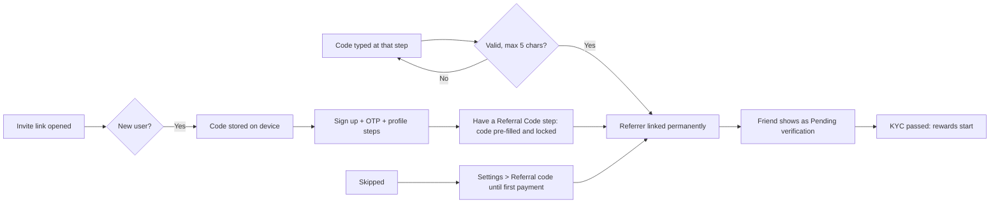
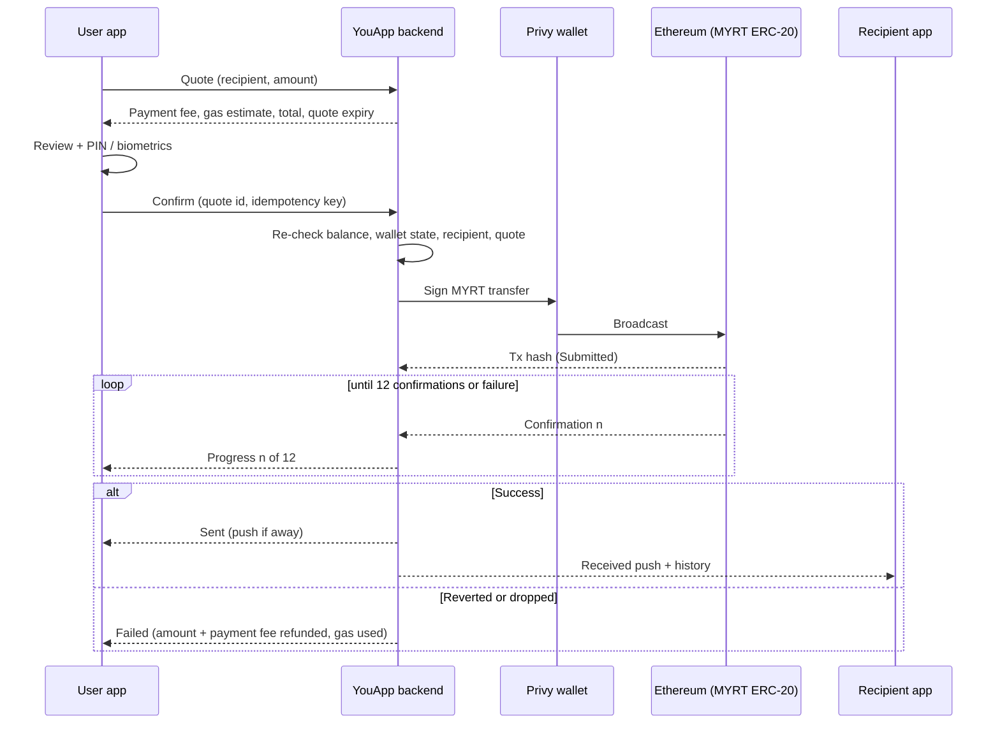

# Wallet 2.0 Full PRD — Elite, Referral, Account Tiers, Scan to Pay, Rewards, Bills, Share, Send & Receive MYRT (Update 3.1.0) · v2 (1)

<aside>
🚧

**Draft v2 (30 Oct 2026) — aligned with the clickable prototype.** Replaces Draft v1 (28 Oct 2026). Main changes: Superhost is now **Elite**; Elite and Merchant roles are granted by admin only (app shows info page + **Contact Admin** to WhatsApp); merchants are added in the admin panel and the app shows their data read-only; referral code max 5 characters and entered in two places; Elite can chat any user; Host accounts have no verification tick; Rewards withdraw goes to **Travel Balance**.

Combined PRD: Send & Receive MYRT (T1–T6) sits in every section under "{section}.T". Items marked ⚠️ depend on Open Questions (section 12). The prototype shows flow and logic only; final UI is defined in Figma. Numbers in the prototype (balances, volumes, pool size) are demo data.
link artifact : https://claude.ai/artifact/DZ2YFW3QXY4ViG4uncePA5

</aside>

## 0. Scope, Model & Changes to Existing PRDs

### 0.1 Modules in this PRD

| # | Module | Type | Priority |
| --- | --- | --- | --- |
| W1 | Onboarding with Referral Code (sign up, OTP, Name, Birthday, Gender, "Have a Referral Code?") and **Settings › Referral code** | Update to 3.0 Login / Onboarding / Settings | P0 |
| W2 | Account Tiers — Free, VIP, SVIP (Choose your plan, Confirmation, VIP months, SVIP review, payment from MYRT, result, renew, Limits) | New | P0 |
| W3 | Business roles — Host (unchanged), **Elite** and **Merchant** (granted by admin; info page + Contact Admin; Elite page, Prize pool, read-only merchant data, merchant dashboard) | New | P0 |
| W4 | Scan to Pay — Wallet 2.0 (tier payment fee, minimum, PIN threshold, Top Up & Pay, limit upsell, cashback, QR routing) | Update to 3.0 Scan and Pay + 3.1.0 M1 | P0 |
| W5 | Referral & Rewards (Refer a Friend, Rewards, Reward Detail, Withdraw to Travel Balance) | Update to 3.0 YouPage referral | P0 |
| W6 | Bills & Mobile Reload | New | P1 |
| W7 | Share This Moment (after Scan to Pay, Top Up, Bills, Send MYRT, tier upgrade) | Update to 3.0 success screens | P1 |
| W8 | Elite chat and Host badge rules | New | P1 |
| T1–T6 | Send & Receive MYRT — on-chain transfer (send to YouApp user or ERC-20 address, receive / My QR, scan routing, on-chain progress, history). Details under "{section}.T" | New | P0 |

### 0.2 Money & Earnings Model

- **MYRT** (Privy wallet, 1 MYRT = 1 MYR) is the only spending balance. In the app it is called **Travel Balance**. Scan to Pay, Bills, Mobile Reload and tier subscriptions are paid from Travel Balance. Settlement to DuitNow / billers follows 3.1.0 (MCash).
- **Booking Balance** (MYR, BetterPay / Stripe) is separate and is never touched by this PRD.
- **Tier** (Free / VIP / SVIP) sets the payment fee, minimum fee, cashback share, per-payment / monthly / yearly limits and direct referral rate.
- **Rewards** are an internal balance that only comes from referral and merchant activity: direct referral rewards, indirect referral rewards (**Elite bonus**), merchant cashback share and prize pool wins. **Withdrawing Rewards moves the money straight into the user's Travel Balance** (MYRT, 1:1, instant, free).
- **Merchant cashback** is funded by the merchant's float. Each claimed cashback is split between the customer (by tier), YouApp, the Elite who brought the merchant and the prize pool.
- **Prize pool** grows from the merchant cashback split. Active Elites are eligible. Winners are picked by a draw. The app and this PRD do not state when or how often draws happen.

### 0.3 Out of Scope

- Top Up method changes (separate 3.1.0 M2 update).
- **In-app application for Elite or Merchant.** Both roles are granted by YouApp admin; the app only shows an info page with a Contact Admin button.
- **Adding or editing merchants in the app.** Merchants, cashback rate, float and thresholds are managed in the admin panel. The app shows the data read-only ⚠️ Q20.
- Final prize pool reward criteria and prize amounts.
- Auto-renewing VIP (VIP never renews on its own).
- Wallet tier downgrade by the user (only by expiry or Elite revoke).

### 0.4 What this PRD changes

#### Changes from PRD v1 (28 Oct 2026)

| Topic | v1 | v2 (this version) |
| --- | --- | --- |
| Naming | Superhost | **Elite** everywhere (tag, page, Elite bonus). "Direct referral" and "Indirect referral" replace first / second layer wording. |
| Becoming Elite | Admin only, no UI | Only path: **You › Business › Elite**. Info page with one button, **Contact Admin**, which opens WhatsApp. No in-app apply, no progress bars, no "In review" state. |
| Merchant role | Merchants registered offline, read-only view | Same logic: admin panel only. Business › Merchant shows an info page + Contact Admin until admin grants the role; then the merchant dashboard. Elite sees registered merchants read-only. |
| Float thresholds | Fixed RM100 pause | Auto-pause and low-float alert thresholds are **set in the admin panel**. |
| Prize pool | "Random draw" with timing hints | A draw only. No schedule, frequency or period wording anywhere. |
| Referral code | Typed in last onboarding step; link once in Refer a Friend | Max **5 characters**. Entered in **two places**: login onboarding step and **Settings › Referral code**. Can be added until the first payment is done. |
| Elite chat | Not covered | Elite can chat any user, even if the user is not a host. |
| Host badge | Not covered | Host accounts do not need the verified tick from Badge Verification. |
| Rewards withdraw | To YouWallet | To **Travel Balance** (MYRT). |
| Limits | Per payment and monthly | Per payment, **monthly and yearly** by tier (values in 6.1, from the prototype). |
| Rewards tabs | Many filters | Tabs **All · Cashback · Referral · Elite**. Elite tab for a non-Elite opens the Elite info page. |

#### Changes to existing PRDs

| Existing PRD | Previous rule | New rule |
| --- | --- | --- |
| 3.0 Login / Onboarding | Ends after profile steps; no referral | Adds optional **Have a Referral Code?** as the last step (Skip allowed). Invite links pre-fill and lock the code. |
| 3.0 Settings | No referral entry | Adds **Settings › Referral code** (gear on You / Host). |
| 3.0 YouPage | Balance card, Invite tile, plan card | Tier badge and tier strip on the balance card; tiles Top Up, Card, Bills, Mobile Reload; Rewards card; **Business** switch next to You at the top (Host / Elite / Merchant). Balance is called Travel Balance. |
| 3.1.0 M4 Limits & Wallet Tier | MCash tier sets limits | Two tier concepts: MCash wallet tier and YouApp Account Tier. ⚠️ Q1 — effective limit is the lower of the two. |
| 3.1.0 M1 Scan to Pay | Debit = amount + gas | Debit = amount + gas + **tier payment fee**. Minimum payment RM20. |
| 3.1.0 M1 personal QR | Personal DuitNow QR blocked | ⚠️ Q2 — prototype allows personal QR as **pay-out only**. Scan also routes YouApp wallet QR / 0x address to Send MYRT. |
| 3.0 Scan and Pay success | Transfer Complete + View receipt | Adds cashback row, payment fee row with tier badge, Share this moment. |
| 3.0 Host tab | Host earnings and quick actions | Unchanged. Host is one segment of the new Business page. |
| Merchant PRD 6.6 | Say Hi does not need Badge Verification | Unchanged. Host accounts show the Host badge instead of the verified tick (W8). |
| Feed | Posts with photos | Adds **receipt card** attachment from Share this moment. |

### 0.T Send & Receive MYRT — Scope (T1–T6)

| # | Module | Type | Priority |
| --- | --- | --- | --- |
| T1 | Send MYRT to a YouApp user (name, @handle, phone, Recent, YouApp friends) | New | P0 |
| T2 | Send MYRT to any Ethereum (ERC-20) address (paste, type, scan) | New | P0 |
| T3 | Receive MYRT — My QR page (QR, @handle, wallet address, Copy, Share, Send shortcut) | Update to 3.0 Get Paid / My QR | P0 |
| T4 | Scan routing — one camera, QR type decides Pay or Send; "Enter wallet address" entry | Update to 3.0 Scan and Pay + 3.1.0 M1 | P0 |
| T5 | On-chain progress, result screens, background completion, notifications | New | P0 |
| T6 | History, receipts and Share this moment for transfers | Update to 3.1.0 M5 | P1 |

**Money model.** MYRT lives in the user's Privy wallet on Ethereum mainnet (ERC-20). A transfer is a direct on-chain ERC-20 transfer. It does not use MCash, DuitNow or the YouApp float. The sender pays the tier **payment fee** and the **gas fee** in MYRT ⚠️ QT1, QT2. The recipient always receives the full amount typed.

**Out of scope (T).** Tokens other than MYRT; networks other than Ethereum mainnet; MCash P2P by phone (API #30) and DuitNow Transfer to bank; request money, split bills, scheduled transfers; address book beyond Recent; transfer limits per tier ⚠️ QT4; reversing a broadcast transfer.

| Existing PRD | Previous rule | New rule |
| --- | --- | --- |
| 3.1.0 — 0.3 Out of Scope | P2P by phone (API #30) out of scope | Still out for MCash. This PRD adds on-chain MYRT transfer through Privy, a different rail. |
| 3.1.0 — M1 / 6.2 rule 4 | Camera only accepts DuitNow merchant QR | Camera reads QR type first: DuitNow merchant → Pay; personal DuitNow → see Q2; YouApp wallet QR or Ethereum address → Send MYRT; else "Unsupported QR". |
| 3.1.0 — M4 Limits | MCash tier limits | MCash limits do not apply to on-chain transfers. No transfer limit in this release; admin cap recommended ⚠️ QT4. |
| 3.1.0 — M5 History | Scan to Pay, Top Up, Convert | Adds **Sent MYRT** and **Received MYRT** (Pending, Completed, Failed). |
| 3.1.0 — M6 Security | Freeze blocks payments | Freeze blocks Send (Receive still works). Every transfer needs PIN or biometrics, at any amount. |
| 3.0 Get Paid (My QR) | "My Ethereum QR", Share QR only | Becomes "My QR": QR with avatar, @handle, grouped address with Copy, accepted tokens, Share QR and Send MYRT. |

## 1. Overview

**Feature name:** Wallet 2.0 — Referral Code, Account Tiers, Elite & Merchant, Scan to Pay, Referral Rewards, Bills & Mobile Reload, Share This Moment, Send & Receive MYRT

**Release:** 3.1.0 · **Platforms:** iOS and Android (including Huawei builds) · **Countries:** Scan to Pay, Bills and Mobile Reload work in Malaysia only (DuitNow / MCash rails). Onboarding, tiers, referral, rewards and Elite work everywhere. Send & Receive works wherever the MYRT wallet is active ⚠️ QT6.

### 1.1 Problem Statement

- YouApp cannot tell who brought a user in. Referral codes are not captured, so referrers cannot be rewarded and growth cannot be measured.
- Every user pays the same fees and has the same limits. Heavy users have no way to pay for better terms, and YouApp has no subscription revenue.
- Top referrers who also bring merchants (Elites) have no place to see their earnings, referrals and merchants. Today this is handled manually by admin.
- Scan to Pay has no fee model, minimum, cashback or clear path when balance is low or the limit is reached.
- Users leave YouApp to pay bills, reload a phone or send money, even though they hold MYRT.
- Success moments end in a dead end. There is no easy way to share them.
- Sending crypto is risky for normal users (wrong address, irreversible). A flow without identity checks and warnings creates support cases and lost funds.

### 1.2 Goals & Expected Impact

| Goal | Expected impact |
| --- | --- |
| Capture referral attribution at login and in Settings (code or link) | Measurable referral growth; correct rewards |
| Offer Free / VIP / SVIP with clear benefits | Subscription revenue; upgrade conversion |
| Give Elites one place for earnings, prize pool, referrals and merchants | Less admin work; Elite retention |
| Give merchants a simple dashboard of their float, cashback and customers | More merchants; healthier floats |
| Make Scan to Pay predictable (fee, minimum, PIN, low balance, limit) | Fewer failed payments; fee revenue |
| Make referral rewards visible and withdrawable to Travel Balance | Trust in the programme; more invites |
| Add Bills, Mobile Reload and MYRT transfers | More reasons to hold and spend MYRT |
| Share this moment after success screens | Organic reach through Feed and external apps |
| Let Elites talk to the people they bring in | Better activation of referred users |

## 2. User & Business Context

### 2.1 Target Users

| User | Situation | Need |
| --- | --- | --- |
| New user from an invite | Opens an invite link or gets a code | Sign up fast; referral applied without extra effort |
| Everyday payer (Free) | Pays DuitNow QR a few times a week | Clear fees; top up and pay when short |
| Heavy payer | Hits Free limits | See savings and upgrade |
| Referrer | Invites friends | See who joined, rewards earned, withdraw |
| Elite | Brings many users and merchants (granted by admin) | Track earnings, prize pool, referrals, merchants; talk to referred users |
| Merchant | Funds cashback to attract users (granted by admin) | See float, cashback, vouchers, customer groups |
| Host | Offers experiences | Keep the 3.0 host tools; be trusted without extra verification steps |
| Malaysian resident | Pays utilities, reloads phone | Pay bills from the same wallet |
| Traveller with MYRT | Splits costs, pays back a friend | Send MYRT fast and safely |

### 2.2 Why This Matters

- **User:** one wallet for shops, bills, reloads and friends, lower fees as they grow, rewards for inviting.
- **Business:** subscription and fee revenue, referral-led growth, merchant-funded cashback, an Elite network that scales merchant acquisition, and MYRT kept inside the network.
- **Risk:** paid tiers outside In-App Purchase and two-level referral earnings and a prize pool draw need store and legal review (Q3, Q4). Open-ended on-chain transfers need AML review (QT5).

## 3. Solution Summary

### 3.1 High-level Solution

1. **W1 Onboarding:** Get Started (email / Google / Apple) → OTP → Name → Birthday (skip) → Gender (skip) → **Have a Referral Code?** (Skip). Invite links pre-fill and lock the code. Later: **Settings › Referral code** until the first payment.
2. **W2 Tiers:** badge and strip on the balance card → Choose your plan (Free / VIP / SVIP) → Confirmation (VIP Monthly with month stepper; VIP Yearly RM120 with RM20 bonus credit) → pay from Travel Balance → result. SVIP needs proof of income review before payment.
3. **W3 Business:** You › **Business** with segments **Host · Elite · Merchant**. Host unchanged. Elite and Merchant show an info page with **Contact Admin** (WhatsApp) until admin grants the role. Active Elite sees earnings, prize pool, merchants (read-only) and referrals. Active Merchant sees the merchant dashboard.
4. **W4 Scan to Pay:** scan → amount (min RM20) → fees → PIN at RM100+ → paid → Share this moment. Low balance → Top Up & Pay. Over limit → upgrade card.
5. **W5 Referral & Rewards:** Refer a Friend → Rewards (All · Cashback · Referral · Elite) → Reward Detail → Withdraw to Travel Balance.
6. **W6 Bills & Mobile Reload:** biller list → account number → fetched amount → pay. Reload: network → number → amount → pay.
7. **W7 Share This Moment:** share sheet → New Feed with receipt card → My Feed.
8. **W8 Chat & badge:** Elite can message any user. Host accounts show the Host badge, not the verified tick.
9. **T Send & Receive:** Send / Receive on the balance card; Scan decides Pay or Send; review → PIN → on-chain progress → result; My QR to receive.

### 3.2 Key Principles

- **Attribution is permanent.** First valid referral wins and can never be changed by the user.
- **Roles are admin-granted.** Elite and Merchant are never self-service; the app only explains and routes to admin.
- **Fees are always visible before paying**, with the tier badge.
- **Upsell at the moment of need**, never as a blocker.
- **Never expose other people's money.** Referral screens never show a friend's shops or payment amounts; shared receipts never show the balance.
- **Rewards are earned, not promised.** The prize pool is a draw for eligible Elites and is never shown as a guaranteed earning.
- **One wallet, one balance (Travel Balance, MYRT)** for payments, bills, reloads, subscriptions, withdrawals and transfers.
- **Show who, then how much** for transfers; the receiver gets exactly what was typed; irreversible means explicit.

## 4. Detailed User Flow

### 4.1 Flow W1 — Referral Code

#### A. Login and onboarding

1. Splash → **Get Started**: email + Login, or Continue with Google / Apple. "18+ and Terms" line.
    - Invalid email → red helper, Login disabled.
    - Opened from an invite link ([youapp.ai/{handle}/{code}](http://youapp.ai/%7Bhandle%7D/%7Bcode%7D)) → the code is stored silently on the device before sign-up.
2. Email → **OTP** modal (6 boxes). Wrong code → red boxes. "Send email OTP again" unlocks after 25 s.
    - Existing user → straight into the app (no onboarding, no referral step). New user → step 3. Google / Apple follow the same rule ⚠️ Q5.
3. **Name** (required, 2–30 characters).
4. **Birthday** (optional, Skip). Must be 18 or older.
5. **Gender** (optional, Skip).
6. **Have a Referral Code?** (last step, progress bar, **Skip** top right). Field "Referral Code", placeholder "Enter code here", Continue.
    - From an invite link → pre-filled, applied, field locked: "Referral code applied". Continue → app.
    - Typed code → Continue validates (spinner): valid → locked and applied; invalid → "Invalid referral code" (edit, retry or Skip).
    - Skip → app with no referrer.
7. Into the app (Discover). The referrer sees the new friend as "Pending verification" until KYC passes.

#### B. Settings › Referral code

1. Gear icon on You / Host → Settings › Wallet › **Referral code**.
2. No referrer and **no payment made yet** → page "Add a referral code": field (placeholder example code), lock notice "Once linked, your referrer can't be changed.", button **Link referrer** (disabled until the field has text).
    - Valid → page changes to "Referred by {name} · {code}", locked.
    - Rejected: unknown code, own code, code of someone in the user's own downline (direct or indirect), code of a banned / deleted user. Message is always "Invalid referral code" except own code ("You can't use your own code.") and downline ("You can't link someone you referred.") ⚠️ Q17.
3. Already referred → locked row "Referred by {name}".
4. No referrer but **first payment done** → row locked: "Referral code can only be added before your first payment." ⚠️ Q25 (what counts as first payment).

#### C. Referral code format

See rules in 6.4 (maximum 5 characters, A–Z and 0–9, not case-sensitive).

### 4.2 Flow W2 — Account Tiers

**Entry points:** tier badge on the balance card (opens Tier benefits sheet), tier strip under the balance card (Free → "Unlock more with VIP"; VIP → "Go SVIP, never renew"; VIP in last 3 days → "Renew"), Tier shortcut on the You tab, Scan to Pay over-limit card, Limits page.

**A. VIP upgrade**

1. Choose your plan opens on the plan above the current one. Segment Free / VIP / SVIP and a swipeable card per plan.
2. VIP card: Monthly / Yearly switch. Monthly "RM10 / month · No auto-renewal". Yearly "RM120 / year · Receive RM20 bonus credit".
3. Not verified (KYC) → "Verify Identity First".
4. **Upgrade to VIP** → Confirmation: order card; Monthly only: **How many months?** stepper 1–11 (RM10 × n); at 10+ months a "Going for 12 months?" card offers Switch to Yearly; Promo Code (tracking only, never changes price); Payment Method **Travel Balance (MYRT) only**; "What happens next" dates; sticky summary; **Subscribe for VIP Membership**.
    - Balance too low → payment row red, "Top up" link, button disabled.
5. Pay → processing → **Result**: success ("You're on VIP", new fee and limit, receipt) with Done / Share This Moment; failed ("You weren't charged. You're still on {tier}.") with Try Again.
6. Yearly: RM20 bonus credit lands in the wallet after payment ⚠️ Q6.

**B. VIP renew.** VIP user sees "Ends on {date}. Doesn't renew on its own." and **Renew VIP**. New period starts after the current end date. Not renewed → Free at 00:00 after the end date, no grace. Push reminder on D-3.

**C. SVIP.** RM1,200 once, permanent. **Apply for SVIP** → Information Review (monthly income minimum RM1,700 and 3 proofs of income, PDF / JPG / PNG, ≤ 5 MB each) → In review → Approved (**Continue to Payment**, Travel Balance only) or Declined (reason naming the file, Try Again / Maybe Later, not charged). Elite approval also grants SVIP (see W3).

**D. Limits page.** Per payment, monthly and yearly limits by tier, with this month's / year's usage (usage includes fees). SVIP shows high fixed numbers, never "Unlimited".

### 4.3 Flow W3 — Business roles (Host, Elite, Merchant)

#### A. Business page

1. You tab → top switch **You | Business** → Business page with segments **Host · Elite · Merchant**.
2. **Host** segment: unchanged from 3.0 (earnings, quick actions, Accepting guests). Hosts switch Host on themselves as in 3.0.
3. **Elite** and **Merchant** segments depend on the role granted by admin (below).
4. Roles can co-exist (a user can be Host and Elite and Merchant).

#### B. Elite — not granted yet (info page)

1. Elite segment shows **Become an Elite**: illustration, "Join and work closely with the YouApp Team.", four benefit rows:
    - **Up to 25% cashback** — Receive up to 25% cashback from the merchant you bring in.
    - **Free SVIP** — You will get one time SVIP tier as free.
    - **A spot in our special prize pool** — Get chance to special pool and get more rewards.
    - **Earning extra referrals bonus** — Get extra bonus from indirect referrals and gain networks.
2. Single button **Contact Admin** → opens WhatsApp chat with the YouApp admin number, with a pre-filled message (name, @handle, user ID) ⚠️ Q22. WhatsApp missing → opens the [wa.me](http://wa.me) web link; if that also fails → toast "Couldn't open WhatsApp. Copy the admin number." with Copy.
3. There is **no other entry** to become an Elite: no card in Refer a Friend, no Apply button, no requirement bars, no In review state. The Rewards › Elite tab opens the same info page for non-Elites.
4. Admin grants Elite in the admin panel. The user gets a push "You're an Elite" and the segment switches to the Elite page.

#### C. Elite — active (Elite page)

Sections in order:

1. **Earnings card:** badge "Elite · since {date}", "Earnings today" total, tiles **Elite bonus** (indirect referral reward) and **Merchant cashback** (each opens Rewards filtered).
2. **Prize pool card:** pool total, status tag Eligible / Not eligible, short body text. Tap → sheet "Prize pool · A privilege for Elites." with Got It. No schedule or frequency is shown.
3. **Your merchants:** "{n} merchants · {m} paused · low float" → Registered Merchant (read-only, section E). Empty: "No merchants yet. Contact YouApp admin to link a merchant."
4. **Referrals:** period chips **Overall · Today · This week · More** (More: Last 7 days, Last 30 days, Last 6 months, This year), groups **Direct referrals** and **Indirect referrals**; each person with verified badge, joined date or "via {name}", volume for the period. Tap a person → sheet (Referral type, Joined, Total volume, **Chat**).
5. **Referral network:** one container, "You" row, each direct referral expands to show their indirect referrals (indented), one open at a time. No volume or reward amounts in this view.
6. Optional **progress card** (referral volume / verified referrals toward Elite targets) only if management keeps retention targets ⚠️ Q7.

#### D. Elite — revoked

1. Admin revokes in the admin panel. Elite page shows "Your Elite status was cancelled" with **Contact Admin**.
2. Free SVIP is removed (back to Free, unless the user paid for a tier) ⚠️ Q11; no new Elite bonus or merchant cashback share; not eligible for the prize pool. Past rewards and past prize wins stay in Rewards.

#### E. Merchants — managed by admin, visible in the app

1. Admin registers the merchant in the **admin panel**: merchant profile, linked Elite (optional), cashback rate (minimum 5%), float, **auto-pause float threshold** and **low-float alert threshold**. Nothing is added or edited in the app.
2. **Registered Merchant** (Elite view, read-only): name, DuitNow merchant · YouApp partner, registered month, "Float left of RM{x}", status Healthy / Low / Paused.
3. **Merchant Detail** (read-only): float card, cashback status line, **Voucher** card (code, extra cashback, copy), **Overview** with month chips (All time, This month, then earlier months) and two cards (Sales + Cashback paid; Customers / Returning / New), **Customers** (gender, age, where they're from — groups only, never individuals).
4. Float below the auto-pause threshold → cashback switches off automatically (Paused) until the merchant tops up above it. Float below the low-float alert threshold → notification to the merchant and the linked Elite. Thresholds come from the admin panel ⚠️ Q23.
5. Each claimed cashback is split: customer by tier (35 / 40 / 45%), YouApp (20 / 15 / 10%), Elite 25%, prize pool 20% ⚠️ Q8. Merchant with no linked Elite: where the 25% goes ⚠️ Q21.
6. Cashback on/off toggle shown in the prototype: confirm whether Elite can pause a merchant or it is admin-only ⚠️ Q20.

#### F. Merchant role

1. **Not granted:** Merchant segment shows **Become Merchant**: "To register as a Merchant, please contact our admin. They'll guide you through the requirements and next steps." Benefits: **Accept seamless digital & QR payments** (support e-wallets and QR payments for all YouApp users); **Track sales and your customer behavior** (monitor daily revenue and stock levels from a single dashboard); **Increase your business reach and visibility** (expand your target audience and attract active local buyers). Button **Contact Admin** (same WhatsApp behavior as Elite).
2. **Granted by admin:** Merchant segment shows the **Business Dashboard**: float and status, cashback rate, promo code / vouchers (code, extra cashback, status Active / Scheduled / Ended, minimum spend, limit per customer, amount paid so far), customer demographics (groups). **No transaction list** (merchant's POS reconciles).
3. Which settings the merchant can change in the app (cashback rate, float top-up, voucher creation) ⚠️ Q20.
4. Customers only ever see their own cashback share.

### 4.4 Flow W4 — Scan to Pay

1. Scan tab → camera (DuitNow Pay logo, "Point at any DuitNow QR", Flash · My QR · Gallery, "Enter wallet address ›").
    - Not verified → state screen (Verify to start paying / in review / rejected with Re-submit).
    - QR routing: DuitNow merchant → step 2; personal DuitNow → ⚠️ Q2; YouApp wallet QR or 0x → Send MYRT (T4); unsupported → toast.
    - Gallery: pick an image with a QR; else "Invalid QR image".
2. Payment screen: merchant name and sub, "You Pay". Open amount: chips 50 / 100 / 120 / 240 + keypad; fixed-price QR: fixed amount. Below RM20 → "Minimum payment is RM 20". Fees box: Gas Fee, Payment Fee (tier badge + rate), Pay from Travel Balance.
3. Checks: enough balance → **Pay Now**; low balance → "RM{x} short" and **Top Up & Pay RM{x}** (sheet with exact / RM100 / RM500 chips) → payment continues after top up; above per-payment limit → red message and "Unlock More Rewards" card, Pay disabled.
4. RM100 or more → PIN (6 digits; wrong PIN shows tries left).
5. Processing (MYRT leg + DuitNow leg per 3.1.0).
6. **Paid**: amount, merchant, Updated Balance, Reference, Cashback (if any), Gas Fee, Payment Fee, Date, usage bar. Done / Share this moment.
7. Failure per 3.1.0.

### 4.5 Flow W5 — Referral & Rewards

1. Entry: Rewards card on You tab, Settings, invite flows.
2. **Refer a Friend:** header (avatar, name, tier tag, Elite tag if Elite); referrer row ("Referred by {name}" or link to Settings › Referral code); My referral code (QR, **code**, link, Share QR / Share link); stats; **Total earned** (direct referral rewards) → View rewards; **Referred friends** list (avatar, name, verified badge, last reward or "Rewards start after verification", amount; unverified rows have a **Chat** button that sends a gentle reminder to verify).
    - There is no "Become an Elite" card here. Elite is reached only through Business › Elite.
3. **Rewards:** card with Total rewards (all sources), tier / Elite tags, **Withdraw** (enabled from RM100), "Withdraw to your Travel Balance". Rate line: "You get {0.2 / 0.3 / 0.4}% from direct referrals" (Elite: + "0.1% Elite bonus from indirect referrals and 25% of merchant cashback"). Tabs **All · Cashback · Referral · Elite**; history grouped by month; each row opens Reward Detail. Elite tab for a non-Elite opens the Elite info page.
4. **Reward Detail** rows by type:
    - Direct referral: Reward type, From, Your bonus (rate + tier tag), Date, Reference, Total rewards.
    - Indirect referral: Reward type, From, Elite bonus 0.1%, Date, Reference, Total.
    - Merchant reward: From (merchant), Total transaction, Customer cashback, Elite share 25% of cashback, Date, Reference, Total.
    - Prize pool win: Reward type, Picked from "{n} Elites", Date, Reference, Total. No period or frequency is shown.
5. **Withdraw:** amount field (min RM100, max RM1,000 per withdrawal ⚠️ Q24, never above rewards balance), chips RM100 / Max, **To: Travel Balance**, Fee Free, Arrives Instantly, "You'll receive". Withdraw → success with amount, new rewards balance, new Travel Balance and reference. Booking Balance is not touched.

### 4.6 Flow W6 — Bills & Mobile Reload

**Bills:** You tab → Bills → search, category chips (All, Utilities, Internet, Government, Other), Recent, sections → pick biller → enter number (account bills 12 digits, Touch 'n Go 10 digits) → Continue → biller check ("No bill found") → Confirm (biller, number, fetched amount fixed, 30 s quotation countdown, YouApp Fee 0%, Cashback only if the biller funds it, Pay from Travel Balance; low balance → Top Up & Pay, shortfall rounded up to RM10, min RM20) → PIN at RM100+ → Paid (View Receipt / Done / Share this moment).

**Mobile Reload:** You tab → Mobile Reload → network (Maxis, CelcomDigi, U Mobile, Unifi Mobile, Yes, Tune Talk) → +60 number → amount (chips 50 / 100 / 120 / 240, min RM20, max RM500, no cashback) → Pay (PIN at RM100+) → Paid.

### 4.7 Flow W7 — Share This Moment

1. From Paid (Scan to Pay), Top Up Landed, Bill / Reload Paid, Send MYRT Sent, or tier upgrade success → **Share this moment**.
2. **Send to** sheet: search, "Share Feed" + recent friends, then WhatsApp, Telegram, Instagram, X, Copy Link. Friend → receipt card sent in chat; app → opens that app with card image and link.
3. Share Feed → **New Feed**: caption pre-filled per type (editable), receipt card attached (✕ removes, "+ Add transaction picture" re-adds), Post disabled when caption empty and no card.
4. Post → My Feed with the new post on top; tap the card → full-screen viewer (likes, comments) → Feed detail.
5. Receipt card: header, title, amount, transaction details (Reference, Tx Hash, Type, Timestamp), payment detail (amount, fees, cashback in green, total). **Never the wallet balance.**

### 4.8 Flow W8 — Elite chat and Host badge

#### A. Elite can chat any user

1. An **active Elite** sees a **Message** option on: Referred friends rows (Refer a Friend), the person sheet on the Elite page, and any other user's profile ⚠️ Q19.
2. The chat opens directly. It does **not** require the other user to be a host, to be a referral, or to have a booking. It does not require the other user's Badge Verification (Say Hi rule from Merchant PRD 6.6).
3. Non-Elite rules do not change: a non-host user can only chat with hosts they have booked; a host can chat with their own referred friends; referrers can send the verify-reminder chat to unverified referred friends.
4. Elite revoked → cannot start new chats; existing conversations stay readable and the other user can still reply ⚠️ Q19.
5. Safety: the other user can mute, block and report; reported Elite chats go to moderation; new-conversation rate limit per day (admin-configurable) ⚠️ Q19.

#### B. Host accounts and the verified tick

1. A user who is a **Host** does not need the verified tick from Badge Verification. Host accounts show the **Host badge (H)** and no tick, in Feed, comments, profiles, cards and chat.
2. A Host is not required to finish Badge Verification to post, comment or chat ⚠️ Q18.
3. Wallet KYC is **not** affected: Scan to Pay, tiers, Rewards, withdraw, Send MYRT still need KYC passed.
4. Non-hosts: the tick appears only after Badge Verification is Approved (unchanged).
5. A verified user who becomes a Host shows the Host badge only (no double badge); if Host is removed, the tick returns when Badge Verification is Approved.

### 4.9 Referral attribution (reference)

### 4.T Send & Receive MYRT — Flows (T1–T6)

#### T4.1 Flow A — Send from the balance card (T1, T2)

1. You tab → balance card → **Send**.
    - KYC not passed or wallet not activated → toast "Verify your identity to send MYRT."
    - Wallet frozen (3.1.0 M6) → sheet "Your wallet is frozen. Unfreeze it in Settings to send MYRT." with Go to Settings.
2. **Send to** opens: search field, Scan QR, Paste address, Recent row, YouApp friends.
3. Pick a recipient:
    - Tap a Recent avatar or friend row → Amount.
    - Type a name / @handle / phone → filtered list → tap a row.
    - Paste a full 0x address: belongs to a YouApp user → that user with "This address belongs to {Name} on YouApp."; own address → "This is your own wallet address. Enter someone else's."; unknown → "Send to this address" (External wallet).
    - Partial or malformed 0x → inline error, no row.
    - Friend without an activated wallet → row dimmed; tap → toast "{Name} hasn't activated a YouApp wallet yet. Ask them to verify first."
4. **Amount:** recipient card with Change; first-time warning for a new recipient (always for external). Keypad in MYRT, "Available MYRT {balance}" + Max, optional note (60 characters, off-chain), live "+ fees · Total" line. Below MYRT 1.00 → "Minimum is MYRT 1.00." Above balance incl. fees → "Not enough MYRT. With fees this needs MYRT {total}."
5. **Review** sheet: recipient, address, network, payment fee (tier badge), gas fee, arrives in, total. External recipient: checkbox must be ticked before Send is enabled.
6. **Send MYRT {amount}** → PIN or biometrics (always, any amount).
7. Server re-checks balance, fees, recipient, wallet state and quote → sign and broadcast. Re-check fails → back to Amount with the matching error; nothing sent.
8. **On-chain progress:** Signed → Submitted (tx hash) → Confirming n of 12 → Sent. The user can leave ("We'll let you know when it lands.").
9. Final: **Sent** screen (or push) or **Transfer didn't go through** (or push) with Try Again / Back to Wallet.
10. A YouApp receiver gets push "{Sender} sent you MYRT {amount}" and a Received entry.

#### T4.2 Flow B — Scan routes by QR type (T4)

| QR read | Route |
| --- | --- |
| DuitNow merchant QR | Scan to Pay (W4), unchanged |
| DuitNow personal QR | ⚠️ Q2 (prototype: allowed, pay-out only; 3.1.0: blocked) |
| YouApp wallet QR (from My QR) | Send MYRT → Amount with that user and banner "YouApp QR scanned. You're sending MYRT, not paying a merchant." |
| Plain Ethereum address QR (0x… or EIP-681 URI) | Send MYRT → Amount with External wallet (or the YouApp user if the address resolves) |
| EIP-681 with another token or chain | Error "This QR asks for a different token or network. YouApp can only send MYRT on Ethereum." |
| Anything else | Toast "This QR isn't a DuitNow or YouApp wallet QR." Camera stays open |

An amount in the QR pre-fills the amount (still editable) ⚠️ QT7.

#### T4.3 Flow C — Enter wallet address (T2)

Scan → **Enter wallet address ›** (verified users only) → multi-line field with Paste / Clear, helper "Ethereum mainnet · ERC-20 only. Starts with 0x, 42 characters." → live validation → preview card (YouApp user, or External wallet + warning) → Continue → Amount.

#### T4.4 Flow D — Receive / My QR (T3)

Balance card → **Receive** (or Scan → My QR) → QR with avatar, name + badge, "@handle · Scan to send me MYRT", wallet address in groups of 4 with Copy Address, accepted tokens card ("Accepts MYRT, USDT and USDC"), actions **Share QR** and **Send MYRT**. Incoming MYRT → push + Received entry. USDT / USDC received from outside follow the 3.0 Top Up / Convert landing rules.

#### T4.5 Flows E–G — Background, failure, share

- **E Background completion:** leaving the progress screen never cancels. The backend tracks the transaction by hash; final state → push + in-app notification + history. App killed before broadcast → nothing sent, no history entry.
- **F Failure:** reverted or dropped → Failed. Message: amount and payment fee are back in the wallet; the gas fee was used by the network and can't be refunded. Try Again → Amount with the same recipient and amount (PIN again).
- **G Share this moment:** Sent → Share this moment → same share sheet as W7. Card: "Sent · MYRT {amount} · to {Name}" (external: "to an external wallet · Ethereum"), Reference, Tx hash, Type "MYRT transfer", Timestamp, Amount, Payment fee, Gas fee, Total. **Never the balance.**

#### T4.6 Sequence (reference)

## 5. UI/UX Behavior

### 5.1 W1 Referral code

| Screen / state | Behavior | Microcopy |
| --- | --- | --- |
| Get Started | Email, Login, Google, Apple, terms line | "By continuing you confirm you are 18+ and agree to the Terms." |
| OTP | 6 boxes, resend after 25 s; wrong → red | "OTP has been sent to your email." / "Incorrect OTP Code. Please try again!" |
| Name / Birthday | Name 2–30 chars; under 18 blocked | "Name must be 2–30 characters." / "You need to be 18 or older to use YouApp." |
| Have a Referral Code? | Progress bar, **Skip** top right, field, Continue | "Have a Referral Code?" / "Enter a referral code to connect with your referrer." / placeholder "Enter code here" |
| Field input | Auto-uppercase, stops at 5 characters, counter 0/5, spaces and symbols stripped on paste | — |
| Checking | Spinner in button | — |
| Invalid | Field error, editable | "Invalid referral code" |
| Applied (typed or link) | Locked, green tick | "Referral code applied" |
| Too many tries | Field disabled for 10 minutes | "Too many attempts. Try again in 10 minutes." |
| Network error | Inline error + retry | "Couldn't check the code. Try again." |
| Settings › Referral code — add | Field, lock notice, **Link referrer** (disabled when empty) | "Add a referral code" / "Enter the code a friend shared with you. You can add one before your first payment." / "Once linked, your referrer can't be changed." |
| Settings › Referral code — errors | Field error | "Invalid referral code" / "You can't use your own code." / "You can't link someone you referred." |
| Settings › Referral code — linked | Locked row | "Referred by {name} · {code}" |
| Settings › Referral code — after first payment | Locked, no field | "You can only add a referral code before your first payment." |

### 5.2 W2 Tiers (key rows)

| Screen / state | Behavior | Microcopy |
| --- | --- | --- |
| Balance card badge | "Free Tier" / "VIP" / "SVIP" pill; opens Tier benefits sheet | — |
| Tier strip | Free: "Unlock more with VIP". VIP: "Go SVIP, never renew". VIP last 3 days: warning "VIP ends in 3 days · Renew". SVIP / pre-KYC: hidden | — |
| Choose your plan | Header chip with current fee and per-payment limit; swipeable cards; tags Current / Popular / Best value; savings estimate when useful | "Current plan: Free · 2.00% fee · RM2,500 per payment" |
| VIP card | Monthly RM10 · No auto-renewal; Yearly RM120 · Receive RM20 bonus credit | — |
| SVIP card | RM1,200 once · Once per lifetime; approval info row | "You only pay after we approve your proof of income." |
| CTA | Upgrade to VIP / Apply for SVIP / Renew VIP / "This Is Your Current Plan" / "Included in Your {tier} Plan" / "Verify Identity First" | — |
| Confirmation | Months stepper 1–11, Switch-to-Yearly card at 10+, Promo, Pay With sheet (Travel Balance only), What happens next, sticky summary | "Plans are paid from your Travel Balance only." |
| Low balance | Row red, Top up link, CTA disabled | "Your balance doesn't cover this plan. Top up to continue." |
| Result | Success / Failed | "You're on VIP" / "Payment failed · You weren't charged." |
| SVIP review | Income field (min RM1,700), 3 upload slots; In review; Declined; Approved | "We're reviewing your documents." ⚠️ Q10 |
| Limits page | Per payment, monthly, yearly with usage bars | "Used amounts include fees." |

### 5.3 W3 Business roles

| Screen / state | Behavior | Microcopy |
| --- | --- | --- |
| Business page header | Top switch "You · Business", gear icon, segments Host / Elite / Merchant | — |
| Elite — info (not granted) | Illustration, title, 4 benefit rows, one button **Contact Admin** | "Become an Elite" / "Join and work closely with the YouApp Team." |
| Merchant — info (not granted) | Illustration, title, 3 benefit rows, **Contact Admin** | "Become Merchant" / "To register as a Merchant, please contact our admin. They'll guide you through the requirements and next steps." |
| Contact Admin — fallback | WhatsApp missing → web link; fails → toast with Copy number | "Couldn't open WhatsApp. Copy the admin number." |
| Elite — earnings card | Badge, "Earnings today", tiles Elite bonus and Merchant cashback | "Elite · since {date}" |
| Elite — revoked | Cancelled notice + Contact Admin | "Your Elite status was cancelled." |
| Prize pool card | Pool total, tag Eligible / Not eligible; no schedule text | "You're part of the program and the pool keeps growing." / "Meet the Elite criteria again to take part." |
| Your merchants | Count row or empty state | "No merchants yet" / "Contact YouApp admin to link a merchant." |
| Referrals | Period chips + More sheet; Direct / Indirect groups; person row; person sheet with Chat | "Choose a period" |
| Referral network | Accordion, indirect rows indented, no amounts | "Indirect referrals are people your direct referrals invited." |
| Registered Merchant / Detail | Read-only cards, float, status Healthy / Low / Paused, Voucher, Overview, Customers (groups) | "Groups only. Individual customers and payments are never shown." |
| Merchant paused | Red float card, status line | "Paused · float is below the minimum" |
| Merchant dashboard (granted) | Float, rate, vouchers, demographics, no transaction list | — |

### 5.4 W4 Scan to Pay (key rows)

| Screen / state | Behavior | Microcopy |
| --- | --- | --- |
| Scan default | Camera, Flash / My QR / Gallery, Enter wallet address link | "Point at any DuitNow QR" / "Scan any DuitNow QR to pay across Malaysia, or a YouApp user's wallet QR to send MYRT." |
| Not verified / camera denied | State screens | "Verify to start paying" / "Allow camera access to scan QR codes." |
| Payment | Chips + keypad; fee box; Pay from Travel Balance | "You Pay" |
| Below minimum | Red helper, Pay disabled | "Minimum payment is RM 20" |
| Low balance | Short note + Top Up & Pay | "RM{x} short. Top up and pay in one step below." |
| Over limit | Red helper + upsell card | "This is above your RM{x} per-payment limit on {tier}." / "Unlock More Rewards" |
| PIN | 6 dots, Forgot PIN | "Payments of RM100 or more need your PIN." |
| Paid | Receipt rows, cashback bar | "Paid" / "to {merchant} · DuitNow QR" |

### 5.5 W5 Referral & Rewards

| Screen / state | Behavior | Microcopy |
| --- | --- | --- |
| Refer a Friend | Hero, QR, code, link, stats, Total earned, friends list; **no** Become an Elite card | "My referral code" / "Link copied." |
| Friends — pending | Amount RM0.00 grey, Chat (reminder) | "Rewards start after verification" |
| Rewards card | Total rewards, Withdraw, rate line | "Withdraw to your Travel Balance" |
| Rewards tabs | All · Cashback · Referral · Elite; Elite tab opens the Elite info page for non-Elites | — |
| Not verified | Rewards locked | "Verify your identity to unlock rewards." |
| Withdraw | Amount, chips RM100 / Max, To: Travel Balance, Fee Free, Arrives Instantly | "Minimum withdrawal is RM100." / "This is more than your rewards balance." / "Maximum RM1,000 per withdrawal." |
| Withdraw success | Amount, new rewards balance, new Travel Balance, reference | "Added to your Travel Balance" |

### 5.6 W6 and W7 (key rows)

| Screen / state | Behavior | Microcopy |
| --- | --- | --- |
| Biller list | Search, chips, Recent | "No biller found" |
| Enter number | 12 digits (TNG 10), Auto-fetch tag | "No bill found for this account." |
| Confirm bill | Fixed amount, countdown, fee 0% | "Quotation refresh in 00:25" / "Amount updated." |
| Reload | Chips, min RM20, max RM500 | "Minimum reload is RM20." / "Maximum reload is RM500." |
| Share sheet | Search, Share Feed + friends, apps row | "Send to" |
| New Feed | Caption pre-filled, card attached, Post | Scan: "Paying has never been this easy! Here's my latest transaction on YouApp." |
| Posted | My Feed, toast | "Posted to your feed." |

### 5.7 W8 Chat and badge

| Screen / state | Behavior | Microcopy |
| --- | --- | --- |
| Message option (Elite) | Chat button on referral rows, person sheet, profiles | "Message" |
| Chat with a non-host (Elite) | Chat opens, input enabled | "Say hi to {First name}" |
| Chat with a non-host (non-Elite) | Blocked as today | "Direct messages aren't available. You can only chat with hosts you've booked." |
| Elite revoked | New chat blocked; old threads readable | "Only Elites can start new chats." |
| Host profile / Feed | Host badge, no tick | — |
| Non-host verified | Tick after Badge Verification Approved | — |

### 5.T Send & Receive MYRT — UI (T1–T6)

#### T5.1 Entry points

| Location | Element | Behavior |
| --- | --- | --- |
| You tab → balance card | **Send** and **Receive** buttons | Only when wallet is active. Before KYC: "Wallet locked until KYC", no buttons. Frozen: Send opens the frozen sheet. |
| Scan screen | **Enter wallet address ›** under My QR | Verified users only. |
| My QR page | **Send MYRT** next to Share QR | Opens Send to. |
| Other profile / chat | — | Not in this release (P2) ⚠️ QT10. |

#### T5.2 Send to

| State | Behavior | Microcopy |
| --- | --- | --- |
| Default | Search, Scan QR, Paste address, Recent (max 8), YouApp friends | Placeholder "Name, @handle, phone or 0x address" |
| No results | Empty block | "No one found" / "Try a name, @handle or phone number, or paste a wallet address." |
| Full address of a user | "YouApp user" section | "This address belongs to {Name} on YouApp." |
| Full unknown address | "Wallet address" section | "Send to this address" / "{0x1234…abcd} · Ethereum" |
| Own address / malformed | Error, no row | "This is your own wallet address. Enter someone else's." / "That doesn't look like a full Ethereum address. It should start with 0x and have 42 characters." |
| Friend without wallet | Dimmed; tap → toast | "Wallet not activated yet" |
| Offline | Local Recent works; remote search error | "You're offline. Connect to search for friends." |

#### T5.3 Enter wallet address

| State | Behavior | Microcopy |
| --- | --- | --- |
| Empty | Field with Paste; Continue disabled | "Enter wallet address" |
| Invalid | Field error | "Ethereum addresses start with 0x." / "Check the address. It should be 42 characters (you have {n})." / "This address's capital letters don't match. Check it again." |
| Valid, YouApp user | Preview + tick line | "This address belongs to {Name} on YouApp." |
| Valid, external | Preview + warning | "Make sure this wallet accepts MYRT on Ethereum. Transfers can't be reversed." |

#### T5.4 Amount

| State | Behavior | Microcopy |
| --- | --- | --- |
| Default | Recipient card, "You send", MYRT 0.00, Available + Max, note, Review disabled | Note placeholder "Add a note (optional)" |
| First-time recipient | Warning | "First time sending to {First name}. Make sure it's the right person." / external: "First time sending to this address. Check every character before you send." |
| Valid | Fees and total line | "+ fees MYRT {fees} · Total MYRT {total}" |
| Errors | Review disabled | "Minimum is MYRT 1.00." / "Not enough MYRT. With fees this needs MYRT {total}." |
| Gas unavailable | Auto-retry every 10 s | "Network fee unavailable right now. Try again in a moment." |
| Note | Max 60 chars | "Only you and {First name} see the note. It isn't stored on-chain." |

Keypad: digits only, max 2 decimals, max 7 integer digits. Content above the keypad scrolls; nothing is covered on a 390×844 screen.

#### T5.5 Review, confirm, progress, results

| Screen | Content |
| --- | --- |
| Review sheet | Header ("You're sending" amount), To, Wallet address (tap for full), Network Ethereum · ERC-20, Payment fee (tier badge + rate), Gas fee, Arrives in ~1 minute, Note, Total. External: acknowledgement checkbox "I've checked this address supports MYRT on Ethereum. Sending to the wrong address or network can't be undone." Quote expired → rows refresh, toast "Fees updated." |
| Confirm | "Confirm Transfer"; PIN pad or biometrics first with "Use PIN"; wrong PIN "Wrong PIN. {n} tries left."; required for every amount |
| Progress | Steps Signed → Submitted to Ethereum (Tx 0x9c4e…b71a) → Confirming n of 12 → Sent; "View on Etherscan"; Back to Wallet; busy-network note after 60 s without a new confirmation |
| Sent | Celebration, amount, "to {Name}", rows To / Payment fee / Gas fee / Total / Tx hash / Network / Reference / Date / Note; **no balance**; Done and Share this moment |
| Failed | "Transfer didn't go through"; no tx hash → "Nothing was sent and you weren't charged."; Try Again / Back to Wallet |

#### T5.6 My QR, notifications, history

- **My QR:** Copy → toast "Address copied."; frozen wallet can still receive.
- **Notifications:** completed (if user left) "MYRT {amount} sent to {Name}."; failed "Transfer didn't go through. MYRT {amount} is back in your wallet."; pending over 10 min "Your transfer is still processing on Ethereum."; received from user "{Sender} sent you MYRT {amount}."; received from address "You received MYRT {amount} from 0x1234…abcd."
- **History:** types **Sent MYRT** and **Received MYRT**; statuses Pending, Completed, Failed; receipt with direction, counterparty, amount, fees and total (sender only), tx hash, confirmations, network, reference, date, note.

## 6. System Behavior & Rules

### 6.1 Tier table (single source for all modules)

| Item | Free | VIP | SVIP |
| --- | --- | --- | --- |
| Price | RM0 | RM10 / month (1–11 months) or RM120 / year (+RM20 bonus credit) | RM1,200 once per lifetime (after approval) |
| Renewal | — | Never automatic; reminder D-3; back to Free at end | Permanent |
| Payment fee | 2.00% | 1.85% | 1.70% |
| Minimum fee | RM1.50 | RM1.50 | None |
| Cashback share | 35% | 40% | 45% |
| YouApp cashback share | 20% | 15% | 10% |
| Per payment limit | RM2,500 | RM5,000 | RM50,000 |
| Monthly limit | RM20,000 | RM150,000 | RM2,000,000 |
| Yearly limit | RM75,000 | RM150,000 | RM2,000,000 |
| Direct referral rate | 0.2% | 0.3% | 0.4% |
| Exclusive merchants | — | — | Yes |
- Values come from the current prototype; the monthly and yearly limits changed from v1 ⚠️ Q26 (VIP monthly equals yearly in the prototype).
- Limits count the amount including fees. Effective limit = lower of Account Tier and MCash wallet tier limit ⚠️ Q1.
- Every tier requires KYC. VIP and SVIP take effect right after payment success.
- VIP renew: new period starts after the current end date. Expiry at 00:00 local time after the end date; no grace.
- **Elite active → SVIP free.** Elite revoked → Free unless a paid tier is still valid ⚠️ Q11.

### 6.2 Subscription payment rules

- Payment method: Travel Balance (MYRT) only. Promo code is attribution only; price never changes.
- VIP Monthly total = RM10 × months (1–11); 12 months must use Yearly. Yearly bonus credit RM20 ⚠️ Q6.
- One pending subscription order per user; repeated taps reuse the same order.
- SVIP: income ≥ RM1,700 and 3 files (PDF / JPG / PNG, ≤ 5 MB). Payment only after approval. Declined → no charge, can re-apply.

### 6.3 Scan to Pay rules

- Minimum payment RM20 (open amount); fixed-price QR uses the QR amount ⚠️ Q15.
- Payment fee = max(amount × tier rate, tier minimum). Gas shown separately. Total debited = amount + payment fee + gas.
- PIN at RM100 or more (amount, not total) ⚠️ Q12. Biometrics may replace PIN per 3.1.0 M6.
- Low balance: Top Up & Pay offers the shortfall (exact), RM100 and RM500; payment continues after the top up lands.
- Per-payment, monthly and yearly limits are checked before Pay.
- Cashback only for merchants with active cashback. Customer receives their tier share. Paused merchants give no cashback.
- QR routing: DuitNow merchant → Pay; YouApp wallet QR / 0x → Send MYRT; personal DuitNow → ⚠️ Q2; other → unsupported.

### 6.4 Referral rules

#### Referral code format

| Rule | Detail |
| --- | --- |
| Length | **Maximum 5 characters.** Auto-generated codes are exactly 5. The field never accepts a 6th character. |
| Characters | A–Z and 0–9 only. Spaces, symbols and emoji are rejected; pasted text is cleaned (spaces removed). |
| Case | Not case-sensitive. Input is shown in uppercase and stored in uppercase. |
| Readability | Auto-generated codes avoid look-alike characters (0 / O, 1 / I / L). |
| Uniqueness | One code per user, unique across all users (case-insensitive). A code is **never reused**, even after the account is deleted. |
| Change | The user cannot change their code. Any change is done by admin. |
| Reserved words | A blocklist (YOUAPP, ADMIN, STAFF, SUPPORT and similar) and a profanity filter apply to every generated or admin-set code. |
| Validation errors | One generic message "Invalid referral code", so a person cannot learn why a code failed. Exceptions: own code and downline codes (see below). |
| Brute-force limit | 5 invalid attempts in 10 minutes per device and per account → locked for 10 minutes. Counts both entry points. |
| Legacy codes | Existing codes longer than 5 characters ⚠️ Q17. The prototype demo code SCAR88 has 6 characters and must be changed. |
| Invite link | [youapp.ai/{handle}/{code}](http://youapp.ai/%7Bhandle%7D/%7Bcode%7D); QR carries the same code. |

#### Attribution rules

- A user can have only one referrer. First valid attribution wins (invite link, login step, or Settings › Referral code) and is permanent. Changing a referrer is an admin action outside the app.
- Settings › Referral code is allowed only if no referrer exists **and no payment has been completed yet** ⚠️ Q25.
- Rejected codes: invalid, own code, code of anyone in the user's downline (direct or indirect), banned or deleted referrer.
- Rewards start only after the referred friend passes KYC; before that the friend shows "Pending verification".
- **Direct referral reward** = friend's payment volume × referrer's tier rate at the time of payment (0.2 / 0.3 / 0.4%). Past rewards keep the rate they were earned at.
- **Indirect referral reward (Elite bonus)** = 0.1% of the volume of the referrer's referrals' referrals, only while the user is an active Elite.
- Copy rule: the app says "Direct referral" and "Indirect referral", and "Elite bonus". It never says "first layer", "second layer" or "level" ⚠️ Q4.
- Friends' shops and payment amounts are never shown to the referrer.

### 6.5 Elite, merchant and prize pool rules

- **Roles:** Elite and Merchant are granted and revoked only in the admin panel. The app never offers an apply form. Contact Admin opens WhatsApp.
- **Elite statuses:** None, Active, Revoked. (No Pending.)
- **Elite benefits:** free SVIP while Elite, up to 25% share of merchant cashback from merchants linked to the Elite, 0.1% Elite bonus on indirect referrals, prize pool eligibility.
- **Retention targets:** whether 30 verified direct referrals and RM100,000 referral volume within a rolling 60 days (counted daily) still apply, and who enforces them ⚠️ Q7.
- **Earnings today** = Elite bonus + merchant cashback share for the current day. Prize pool wins are excluded; Total rewards includes them.
- **Merchant setup:** admin panel only. Cashback rate minimum 5%. Float, auto-pause threshold and low-float alert threshold are admin-configurable. The auto-pause is enforced at payment time, not only on the dashboard.
- **Cashback split per claim:** customer 35 / 40 / 45% by tier, YouApp 20 / 15 / 10%, Elite 25%, prize pool 20% ⚠️ Q8.
- **Prize pool:** active Elites are eligible; winners are chosen by a draw; a win is credited to Rewards as "Prize pool win". Pool total is a live value. Reward criteria are published later. The app does not show draw timing, frequency or period.
- **Privacy:** merchant customer data is shown only as groups, never individuals; groups under a minimum size are hidden ⚠️ Q16.

### 6.6 Rewards and withdraw rules

- Total rewards = direct + indirect + merchant cashback share + prize pool wins − withdrawals.
- **Withdraw:** minimum RM100, maximum RM1,000 per withdrawal ⚠️ Q24, never above the rewards balance. Destination is the user's **own Travel Balance (MYRT)**, 1 RM = 1 MYRT, free, instant. Booking Balance is never a destination.
- One withdrawal at a time; a second tap waits for the first.
- Not verified → rewards accrue but are locked ⚠️ Q13.

### 6.7 Bills and Mobile Reload rules

- Account bills: amount fetched and fixed; quotation valid 30 s then refreshed. Reload: RM20–RM500.
- YouApp fee 0% ⚠️ Q14. Cashback only where the biller funds it; none on reloads. PIN at RM100 or more.
- Top Up & Pay: shortfall rounded up to RM10, minimum RM20. Account bills below RM20 allowed at the fetched amount ⚠️ Q15.

### 6.8 Share This Moment rules

- Only on success screens (never failed or pending).
- The receipt card never includes the wallet balance. Cashback, fees and tx hash are allowed.
- Caption is pre-filled and editable; Post needs a caption or the card. Posts follow 3.0 Feed visibility. Removing the post removes the card.

### 6.9 Chat and badge rules

- Elite active → can start a chat with any user (host or not, referred or not, booked or not).
- Non-Elite rules unchanged. Revoked Elite cannot start new chats; existing threads remain.
- Chat limits, mute, block and report apply to every user. New-conversation limit per day is admin-configurable ⚠️ Q19.
- Host accounts show the Host badge and no verified tick, and are not required to complete Badge Verification for social actions ⚠️ Q18. Wallet KYC rules are unchanged.

### 6.10 Admin panel configuration (reference for Tech)

| Setting | Notes |
| --- | --- |
| Grant / revoke Elite | Sets status; triggers SVIP grant / removal and push |
| Grant / revoke Merchant | Creates merchant profile and dashboard access |
| Merchant: cashback rate, float, linked Elite | Rate minimum 5% |
| Merchant: auto-pause threshold, low-float alert threshold | Per merchant or global default ⚠️ Q23 |
| Cashback split | Customer by tier, YouApp, Elite, prize pool |
| Prize pool draw | Winners and amounts; no timing shown in the app |
| Change referrer | Admin only, with audit log |
| Referral code: edit, blocklist | Admin only |
| Admin WhatsApp number and pre-filled message | ⚠️ Q22 |
| Chat: new-conversation limit for Elite | ⚠️ Q19 |
| Transfer caps (T) | Per transfer, day, month; default off ⚠️ QT4 |

### 6.11 Data dependencies

| Data | Source | If missing |
| --- | --- | --- |
| Tier, period end, rates, limits | Tier service | Show Free values; block upgrade with retry |
| Travel Balance | Privy wallet | Last known with "Updating…"; disable Pay |
| Referral graph, rewards ledger | Referral service | Hide lists; "Couldn't load rewards" |
| Elite / Merchant role and status | Admin panel service | Show info page; hide Elite page |
| Merchant float, cashback, insights | Merchant service | Last known with "Updated {time}" |
| Prize pool total | Pool ledger | Hide amount; keep status |
| Admin WhatsApp contact | Config service | Hide button; show "Contact admin from Help" |
| Billers, amounts | MCash biller APIs | Biller disabled "Temporarily unavailable" |

### 6.T Send & Receive MYRT — Rules (T1–T6)

#### T6.1 Eligibility (checked in order)

1. KYC passed and wallet activated, else blocked with the KYC message.
2. Wallet frozen → Send blocked, Receive allowed.
3. Account banned / under review → Send and Receive blocked.
4. Feature flag on for this app version.
5. YouApp recipient must have an activated wallet.
6. Country: no restriction in this release ⚠️ QT6.

#### T6.2 Address rules

- Valid = 0x + 40 hex characters. Mixed-case must pass EIP-55 checksum; all-lowercase or all-uppercase accepted. Whitespace stripped; ethereum: URIs parsed per EIP-681.
- Blocked: own address, zero address, MYRT token contract, YouApp treasury / fee addresses, known burn addresses → "You can't send MYRT to this address."
- An address matching a YouApp user is treated as that user.
- Smart contract addresses: allowed with warning "This is a smart contract address. Make sure it can receive MYRT." ⚠️ QT8.

#### T6.3 Pre-send re-check (server, after PIN)

Quote still valid; balance ≥ amount + payment fee + gas now; wallet not frozen and account not restricted; recipient still valid; no identical transfer (same sender, recipient, amount) in the last 60 s without confirmation ⚠️ QT9. Any failure → back to Amount with the matching error; nothing sent.

#### T6.4 Fees and Max

- **Payment fee** = max(amount × tier rate, tier minimum), same tier table as 6.1 ⚠️ QT1.
- **Gas fee** = live estimate in MYRT with a buffer, shown as one number (prototype placeholder MYRT 1.00) ⚠️ QT2.
- **Total debited** = amount + payment fee + gas. The recipient receives the amount only.
- **Max:** amount = (balance − gas) ÷ (1 + rate); if that fee is below the minimum, amount = balance − gas − minimum; rounded down to 2 decimals. Example: balance 1,240.50, Free, gas 1.00 → Max 1,215.19.
- Minimum amount MYRT 1.00 (configurable). Fees rounded half-up to 2 decimals.

#### T6.5–T6.10 Quote, lifecycle, limits, idempotency, QR, data

- **Quote** is created when Review opens and valid 60 s. Expired → re-quote; if higher, ask again (never auto-send at a higher price). Gas above the buffer at broadcast → "Fees changed. Review again."
- **Lifecycle:** Draft (nothing stored) → Signed → Submitted (history Pending) → Confirming (1–11) → Completed at 12 confirmations → or Failed (reverted, dropped, replaced: amount + payment fee refunded; gas on failed on-chain transactions is not refunded). Dropped after 30 min → one re-broadcast with higher gas paid by YouApp; still not mined at 60 min → Failed. Never show Completed before 12 confirmations; the counter can go down on a reorg.
- **Limits:** no per-transfer or monthly limit in this release; balance is the only limit. Admin-configurable caps and a new-account velocity rule are recommended, default off ⚠️ QT4. MCash and Account Tier payment limits do not apply.
- **Idempotency:** one active transfer per sender until Submitted; every Confirm carries an idempotency key; balance refreshes on focus and after each transfer.
- **QR payload:** EIP-681 MYRT URI + YouApp identifier so YouApp can show the name; other wallets still read the address ⚠️ QT7. Scanning your own QR → "This is your own QR."
- **Data:** balance (Privy / indexer), user ↔ address mapping (user service), tier (tier service), gas (oracle), tx status (indexer / Privy webhooks), Recent recipients (transfer history). Missing gas or tier → Review blocked with retry.

## 7. Edge Cases

| # | Module | Scenario | Expected behavior |
| --- | --- | --- | --- |
| E1 | W1 | Invite link opened, user then types a different code | Link code wins (locked); typed field not editable |
| E2 | W1 | Invite link from a deleted / banned user | Code ignored; referral step empty |
| E3 | W1 | Existing user opens an invite link | No change to their referrer |
| E4 | W1 | User kills the app on the referral step | On reopen, onboarding resumes at the referral step |
| E5 | W1 | User pastes a 6+ character code | Field keeps the first 5 characters only; counter shows 5/5 |
| E6 | W1 | Code typed in lowercase or with spaces | Uppercased and spaces removed before validation |
| E7 | W1 | User skips at login, then pays, then opens Settings › Referral code | Locked: "You can only add a referral code before your first payment." |
| E8 | W1 | User skips at login and opens Settings › Referral code before any payment | Add form is available |
| E9 | W1 | Same device tries many wrong codes across login and Settings | Shared counter; lock for 10 minutes after 5 misses |
| E10 | W1 | Legacy code longer than 5 characters (e.g. SCAR88) | Handled per Q17 |
| E11 | W2 | VIP user buys more months before expiry | Treated as Renew; dates extend from current end |
| E12 | W2 | Balance drops below price between Confirmation and Subscribe | Subscribe fails; "Not enough balance" |
| E13 | W2 | Promo code is the user's own | Rejected "You can't use your own code." |
| E14 | W2 | SVIP approved but user never pays | Approval valid for a limited time ⚠️ Q10; then re-apply |
| E15 | W2 | Elite revoked while user also bought VIP earlier | Keeps the highest still-valid paid tier ⚠️ Q11 |
| E16 | W3 | Non-Elite taps the Elite tab in Rewards | Opens the Elite info page (Contact Admin) |
| E17 | W3 | Contact Admin tapped without WhatsApp installed | Web link; if it fails, toast with Copy number |
| E18 | W3 | Admin grants Elite while the user is on the info page | Page switches to the Elite page on next refresh / push |
| E19 | W3 | Admin revokes Elite while user is reading the Elite page | Next refresh shows the cancelled notice; Elite-only actions (chat) stop |
| E20 | W3 | Elite revoked | SVIP removed (unless paid), no new bonus or merchant share, prize pool not eligible; past rewards stay |
| E21 | W3 | Merchant float below admin auto-pause threshold | Cashback off at payment time; status Paused; notifications |
| E22 | W3 | Merchant tops up while paused | Cashback resumes on next payment; notification |
| E23 | W3 | Merchant float exactly at the threshold | Active (pause only when strictly below) |
| E24 | W3 | Elite has no merchants | Empty state with contact-admin text |
| E25 | W3 | Referral joined mid-period | Volume before join date = 0 |
| E26 | W3 | Prize pool win while revoked | Win stays in Rewards; not eligible for next draws |
| E27 | W3 | User is Host, Elite and Merchant | All three segments active; no conflict |
| E28 | W4 | Fixed-price QR below RM20 | Allowed ⚠️ Q15 |
| E29 | W4 | Top Up & Pay: top up succeeds, payment fails | Top up stays in wallet; payment failed screen |
| E30 | W4 | Amount exactly at per-payment limit (with fees) | Limit checked on amount + fees |
| E31 | W4 | Merchant paused between scan and pay | Pay proceeds without cashback |
| E32 | W5 | Link referrer with code of own indirect referral | Rejected (would create a loop) |
| E33 | W5 | Withdraw twice quickly | One withdrawal; second blocked until first completes |
| E34 | W5 | Rewards balance changes during withdraw | Server re-checks; error if above balance |
| E35 | W5 | Withdraw while Travel Balance is hidden or low | Works; balance only increases |
| E36 | W6 | Quotation expires on confirm | Amount refreshes; user confirms again |
| E37 | W6 | Reload to an invalid / ported number | "Number not supported by {network}" |
| E38 | W7 | Post fails offline | Toast error; draft kept |
| E39 | W8 | Elite messages a non-host who never opened chat | Chat opens; recipient gets a normal chat notification |
| E40 | W8 | Elite revoked with open conversations | Threads stay; no new chats |
| E41 | W8 | Verified user becomes Host | Host badge replaces the tick |
| E42 | W8 | Host removes Host role | Tick returns if Badge Verification is Approved |
| E43 | All | KYC rejected after tier purchase | Tier stays; payments blocked until KYC passes ⚠️ Q13 |

### 7.T Send & Receive MYRT — Edge Cases

| # | Scenario | Expected behavior |
| --- | --- | --- |
| ET1 | Double tap on Send / Confirm | One transfer only (idempotency key) |
| ET2 | App killed after PIN, before broadcast | Nothing sent; no history entry; no fee |
| ET3 | App killed after broadcast | Transfer continues; push on final state |
| ET4 | Balance drops between Review and PIN | Re-check fails → Amount with "Not enough MYRT…" |
| ET5 | Gas spikes after quote | Absorb within buffer, or ask to review again |
| ET6 | Transaction dropped from mempool | Re-broadcast once, then Failed with refund |
| ET7 | Chain reorg | Confirmations may go down; no Completed before 12 |
| ET8 | Recipient deletes account after selection | "This person can't receive MYRT right now." |
| ET9 | Recipient's wallet frozen | Allowed (receiving is allowed when frozen) |
| ET10 | Sender frozen mid-flow | Re-check fails → frozen sheet; nothing sent |
| ET11 | Address with wrong checksum | Inline error; Continue disabled |
| ET12 | Look-alike address (same first and last 4 characters as a Recent recipient) | Review warning "This address looks similar to {Name}'s but isn't the same." |
| ET13 | Clipboard replaced by malware | Full address on tap in review; first-time warning for unknown address |
| ET14 | Send to MYRT contract, zero address or treasury | Blocked |
| ET15 | Send to a smart contract | Allowed with warning ⚠️ QT8 |
| ET16 | Scan own QR | "This is your own QR." |
| ET17 | QR includes an amount / another token or network | Pre-filled and editable ⚠️ QT7 / error |
| ET18 | Amount equals Max | Allowed; balance after ≈ 0 |
| ET19 | Minimum fee larger than percentage | Minimum applied and shown |
| ET20 | Tier changes mid-flow | Next quote uses the new rate |
| ET21 | Offline after PIN | Retry with the same idempotency key; after 30 s without broadcast → "Couldn't reach the network. Nothing was sent." |
| ET22 | Two devices sending at once | Server serialises; second waits or fails re-check |
| ET23 | Incoming MYRT from a sanctioned address ⚠️ QT5 | Arrives on-chain; flagged for compliance |
| ET24 | Old app version without Send | Entry points hidden; scanning a YouApp QR shows "Update YouApp to send MYRT." |
| ET25 | Network busy for hours | Stays Pending; push at 10 min; support link after 60 min |

## 8. QA Section

### A. W1 Referral code

| ID | Type | Scenario | Steps | Expected Result |
| --- | --- | --- | --- | --- |
| OB-01 | Positive | New user, valid 5-character code | Sign up → OTP → Name → skip DOB / gender → enter valid code → Continue | "Referral code applied"; app opens; referrer sees friend as Pending verification |
| OB-02 | Positive | Invite link | Open link → sign up → reach referral step | Code pre-filled, locked, applied |
| OB-03 | Negative | Invalid code | Enter "ZZZZZ" → Continue | "Invalid referral code"; can edit or Skip |
| OB-04 | Positive | Skip at login | Tap Skip | App opens, no referrer; Settings › Referral code available |
| OB-05 | Negative | Own code | Use own code in Settings | "You can't use your own code." |
| OB-06 | Negative | 6-character input | Type or paste "ABC123" | Only "ABC12" is kept; counter 5/5 |
| OB-07 | Positive | Lowercase and spaces | Paste " ab c3 " | Becomes "ABC3"; validated as uppercase |
| OB-08 | Negative | Symbols / emoji | Type "AB-C!" | Disallowed characters rejected |
| OB-09 | Negative | Brute force | 5 wrong codes in 10 minutes (login + Settings mixed) | Locked 10 minutes with message |
| OB-10 | Positive | Add in Settings before first payment | Skip at login → Settings › Referral code → valid code → Link referrer | Page shows "Referred by {name}", locked |
| OB-11 | Negative | Add after first payment | Skip → complete one payment → open Settings › Referral code | Locked message; no field |
| OB-12 | Negative | Downline code | Use code of someone you referred | "You can't link someone you referred." |
| OB-13 | Positive | Link button state | Open Settings › Referral code | Link referrer disabled while empty |
| OB-14 | Negative | Wrong OTP / under 18 / short name | Standard onboarding errors | Same messages as 3.0 |
| OB-15 | Edge | Link from banned referrer | Open link → sign up | Referral step empty |

### B. W2 Tiers

| ID | Type | Scenario | Steps | Expected Result |
| --- | --- | --- | --- | --- |
| TR-01 | Positive | VIP monthly, 1 month | Free user → Choose plan → VIP Monthly → Subscribe | RM10 debited from Travel Balance; "You're on VIP"; fee 1.85% |
| TR-02 | Positive | VIP monthly, 3 months | Stepper to 3 | Order card RM30; end date +3 months |
| TR-03 | Positive | Switch to Yearly from 10+ months | Stepper to 10 → Switch | Yearly RM120 with RM20 back to wallet |
| TR-04 | Positive | VIP Yearly | Yearly → Subscribe | RM120 debited; RM20 bonus credit lands |
| TR-05 | Negative | Low balance | Balance below price | Row red; Top up link; CTA disabled |
| TR-06 | Positive | Renew VIP | VIP user → Renew VIP → Pay | New end = old end + period |
| TR-07 | Positive | Expiry | VIP passes end date | Tier Free; fee 2.00% |
| TR-08 | Positive | SVIP apply and pay | Apply → income 2,000 → 3 files → Submit → approve → pay | RM1,200 debited; SVIP permanent |
| TR-09 | Negative | SVIP low income / big file / declined | Income 1,200; 6 MB file; decline | Errors; not charged; Try Again |
| TR-10 | Negative | KYC not passed | Unverified opens Choose your plan | "Verify Identity First" |
| TR-11 | Positive | Limits page | Open Limits for each tier | Per payment, monthly, yearly match 6.1 |
| TR-12 | Positive | Pay With sheet | Tap Payment Method | Travel Balance only |

### C. W3 Elite, merchant, Business

| ID | Type | Scenario | Steps | Expected Result |
| --- | --- | --- | --- | --- |
| EL-01 | Positive | Business page | You → Business | Segments Host / Elite / Merchant |
| EL-02 | Positive | Elite info page | Non-Elite opens Elite segment | Title, 4 benefits, only button Contact Admin |
| EL-03 | Positive | Contact Admin | Tap Contact Admin | WhatsApp opens with admin chat and pre-filled message |
| EL-04 | Negative | No WhatsApp | Tap Contact Admin on a device without WhatsApp | Web link or Copy-number toast |
| EL-05 | Negative | No other Elite entry | Open Refer a Friend, Rewards, Settings | No Become an Elite card, Apply button or requirement bars |
| EL-06 | Positive | Rewards › Elite for non-Elite | Tap Elite tab | Elite info page |
| EL-07 | Positive | Admin grants Elite | Grant in admin panel | Push; Elite page; Elite tag; free SVIP |
| EL-08 | Positive | Earnings card | Open Elite page | Earnings today = Elite bonus + merchant cashback; prize wins excluded |
| EL-09 | Positive | Prize pool | Eligible Elite opens the card | Pool total, tag, sheet; no timing wording anywhere |
| EL-10 | Positive | Referrals period | Tap Today, This week, More › Last 30 days | Direct / Indirect groups update; More label shows selection |
| EL-11 | Positive | Referral network | Expand A, then B | A closes when B opens; no amounts |
| EL-12 | Positive | Merchants read-only | Open Registered Merchant and Detail | Data visible; no add, edit or delete controls |
| EL-13 | Positive | Auto-pause | Float drops below admin threshold | Paused; no cashback on next payment; notifications |
| EL-14 | Positive | Resume | Merchant tops up above threshold | Cashback resumes |
| EL-15 | Positive | Admin changes threshold | Change in admin panel | New value applies at next payment |
| EL-16 | Positive | Revoke | Admin revokes | Cancelled notice; SVIP removed; no new bonus; not eligible for prize pool |
| EL-17 | Positive | Merchant info page | Non-merchant opens Merchant segment | Title, 3 benefits, Contact Admin |
| EL-18 | Positive | Merchant dashboard | Admin grants Merchant | Float, rate, vouchers, demographics; no transaction list |
| EL-19 | Positive | Host unchanged | Open Host segment | Same as 3.0 Host tab |
| EL-20 | Security | Customer privacy | Inspect merchant overview and customers | Groups only; no individual customer or payment |

### D. W4 Scan to Pay

| ID | Type | Scenario | Steps | Expected Result |
| --- | --- | --- | --- | --- |
| SP-01 | Positive | Pay RM50 Free | Scan merchant QR → 50 → Pay | Payment fee 1.50 (min); gas shown; no PIN |
| SP-02 | Positive | Pay RM200 VIP | VIP → 200 | Payment fee 3.70; PIN asked |
| SP-03 | Positive | SVIP no minimum | SVIP → 20 | Payment fee 0.34 |
| SP-04 | Negative | Below RM20 | Enter 15 | "Minimum payment is RM 20"; Pay disabled |
| SP-05 | Positive | Top Up & Pay | Balance RM12.40 → 50 → Top Up & Pay | Top up lands; payment completes |
| SP-06 | Negative | Over per-payment limit | Free → 3,000 | Red message; upgrade card; Pay disabled |
| SP-07 | Positive | Cashback / paused merchant | Pay at active and paused merchant | Cashback row only for active |
| SP-08 | Positive | YouApp QR routing | Scan another user's wallet QR | Send MYRT opens |
| SP-09 | Edge | Personal DuitNow QR | Scan personal QR | Per Q2 decision |

### E. W5 Referral & Rewards

| ID | Type | Scenario | Steps | Expected Result |
| --- | --- | --- | --- | --- |
| RF-01 | Positive | Friend pending | Friend not verified | "Rewards start after verification", RM0.00 |
| RF-02 | Positive | Direct reward after KYC | Friend verifies and pays RM100 | Referrer earns rate × RM100 |
| RF-03 | Positive | Indirect reward (Elite) | Friend's friend pays RM100 | Elite earns 0.1% ("Elite bonus"); non-Elite earns nothing |
| RF-04 | Positive | Rewards tabs | Tap All / Cashback / Referral / Elite | Lists match; labels say Direct / Indirect; no "first / second layer" |
| RF-05 | Positive | Reward Detail types | Open each type | Rows per 4.5; prize win has no draw period |
| RF-06 | Positive | Withdraw to Travel Balance | Rewards 899.85 → withdraw 500 | Success; rewards 399.85; Travel Balance +500; Booking Balance unchanged |
| RF-07 | Negative | Below min / above max / above balance | Enter 50; 1,500; more than balance | Errors; button disabled |
| RF-08 | Negative | Not verified | Unverified opens Rewards | Locked |
| RF-09 | Security | Privacy | Inspect friend rows and details | No shop names or payment amounts |

### F. W6 Bills, Reload and W7 Share

| ID | Type | Scenario | Steps | Expected Result |
| --- | --- | --- | --- | --- |
| BL-01 | Positive | Pay a bill | Bills → biller → 12 digits → Continue → Pay | Fetched amount; fee 0%; Paid |
| BL-02 | Negative | No bill / no biller | Unknown account; search "zzz" | "No bill found" / "No biller found" |
| BL-03 | Edge | Quotation refresh | Wait 30 s on confirm | Amount re-fetched |
| MR-01 | Positive | Reload RM50 | Mobile Reload → network → number → 50 → Pay | Paid; no cashback |
| MR-02 | Negative | Below RM20 / above RM500 | Enter 10; 600 | Errors; Pay disabled |
| SM-01 | Positive | Share Feed after payment | Paid → Share this moment → Share Feed → Post | Post on My Feed with receipt card |
| SM-02 | Security | No balance on card | Inspect every card type | No Updated Balance row |
| SM-03 | Negative | Empty post | Remove card and clear caption | Post disabled |

### G. W8 Chat and badge

| ID | Type | Scenario | Steps | Expected Result |
| --- | --- | --- | --- | --- |
| CH-01 | Positive | Elite chats a non-host | Elite opens Message on a non-host user | Chat opens; can send |
| CH-02 | Negative | Non-Elite chats a non-host | Non-Elite tries to message a non-host | Blocked with existing message |
| CH-03 | Positive | Chat from referral row / person sheet | Elite taps Chat | Chat opens |
| CH-04 | Negative | Elite revoked | Revoke → try new chat | Blocked; old thread readable |
| CH-05 | Positive | Recipient safety | Recipient mutes / blocks / reports | Works as for any user |
| CH-06 | Positive | Host badge | Open a Host profile and Feed post | Host badge, no verified tick |
| CH-07 | Positive | Host without Badge Verification | Host with Badge Verification not started posts, comments, chats | Allowed ⚠️ Q18 |
| CH-08 | Regression | Wallet KYC for host | Host without wallet KYC opens Scan | Still blocked until KYC passes |
| CH-09 | Positive | Non-host tick | Non-host with Badge Verification Approved | Tick shown |

### H. Regression & Performance

| ID | Type | Scenario | Expected Result |
| --- | --- | --- | --- |
| RG-01 | Regression | 3.1.0 DuitNow settlement | Two-leg settlement and statuses per 3.1.0 |
| RG-02 | Regression | MCash limits | Lower of MCash and tier limit applied |
| RG-03 | Regression | Host tab content | Upcoming, listings, reviews unchanged |
| RG-04 | Regression | Booking payments | BetterPay / Stripe unchanged |
| PF-01 | Performance | Elite page with 500 referrals | First content under 1.5 s; list paginated |
| PF-02 | Performance | Rewards history with 1,000 entries | Smooth scroll; months lazy-loaded |

### 8.T Send & Receive MYRT — QA

| ID | Type | Scenario | Steps | Expected Result |
| --- | --- | --- | --- | --- |
| EN-01 | Positive | Send / Receive visible | Verified user opens You tab | Buttons under the balance |
| EN-02 | Negative | KYC not passed | Unverified user | No buttons; "Wallet locked until KYC" |
| EN-03 | Negative | Frozen taps Send | Freeze → Send | Frozen sheet; Receive still opens |
| ST-01 | Positive | Pick Recent | Send to → first Recent | Amount with that user; no first-time warning |
| ST-02 | Positive | Search by @handle / phone | Type handle, then phone | Matching user listed |
| ST-03 | Positive | Paste a YouApp user's address | Paste address | "YouApp user" section + tick line |
| ST-04 | Negative | Own / malformed / bad checksum / blocked address | Paste each | Matching error; no row |
| ST-05 | Negative | Friend without wallet | Tap row | Toast; stays |
| AM-01 | Positive | Free tier fee | Free → 100 | "+ fees MYRT 3.00 · Total MYRT 103.00" (2.00 + 1.00 placeholder gas) |
| AM-02 | Positive | Minimum fee | Free → 50 | Payment fee 1.50 |
| AM-03 | Positive | Max | Balance 1,240.50, Free, Max | 1,215.19 |
| AM-04 | Negative | Below minimum / above balance | 0.50; full balance | Errors; Review disabled |
| AM-05 | Negative | External without acknowledgement | Review external | Send disabled until ticked |
| AM-06 | Edge | Quote expires | Open review → wait 61 s → Send | Fees refresh; re-confirm if higher |
| CF-01 | Positive | PIN for any amount | Send MYRT 1.00 | PIN asked |
| PR-01 | Positive | Confirmations | Send | Counter 1 → 12; Sent screen |
| PR-02 | Positive | Leave during progress | Back to Wallet | You tab; push on completion |
| PR-03 | Negative | Reverted / rejected before broadcast | Mock each | Failed with refund; or "Nothing was sent" |
| RS-01 | Positive | Sent screen and share | Complete a send → Share | No balance row; tx hash; card without balance |
| SC-01 | Regression | DuitNow merchant QR | Scan merchant QR | Scan to Pay as in W4 |
| SC-02 | Positive | YouApp QR / 0x QR | Scan each | Amount with user / External wallet |
| SC-03 | Negative | Other token QR / unsupported QR / own QR | Scan each | Matching message |
| RC-01 | Positive | My QR | Open Receive | QR, @handle, grouped address, tokens, Share QR, Send MYRT |
| SE-01 | Security | Double tap / replay / tampered amount | Repeat, replay, change request | One transfer; rejected |
| SE-02 | Security | Freeze between review and PIN | Freeze from another device | Blocked; nothing sent |
| TRG-01 | Regression | Limits page after transfers | Send, open Limits | MCash usage unchanged |

**Clarifications needed before QA sign-off:** Q1, Q2, Q6, Q7, Q8, Q12, Q14, Q15, Q17, Q18, Q19, Q20, Q23, Q25, Q26, QT1, QT2, QT4, QT7, QT8, QT9. Test accounts: Free / VIP (normal and ending in 3 days) / SVIP; Elite active and revoked; merchant active and paused; Host with and without Badge Verification; user with and without referrer; user before and after first payment. Mocks: SVIP review, prize pool draw, MCash biller responses, Feed failures, WhatsApp missing, testnet MYRT with reverted and dropped transactions.

**Risk areas QA should focus on:** fee and limit calculations; referral code validation (5 characters, case, brute-force lock) and attribution permanence; tier transitions (upgrade, renew, expiry, Elite grant / revoke); merchant auto-pause at admin thresholds; balance never shown on shared cards; merchant data privacy; Elite chat permissions; withdraw landing in Travel Balance only; idempotency and status accuracy for transfers; Scan routing must not break DuitNow.

## 9. Developer Notes (non-technical)

- One tier table drives every screen (fees, limits, cashback share, referral rate). Never hardcode tier values per screen.
- Referral attribution is decided once and stored permanently. The invite link code must survive install and sign-up. Validate the code (length 5, charset, case-insensitive, blocklist, brute-force limit) on the server; the app only mirrors the rules.
- Fees are calculated on the server at confirmation time and shown before the user confirms. The app never computes the final charged amount on its own.
- Limit checks use amount + fees and the lower of the MCash tier and Account Tier limits.
- Tier changes must be atomic with payment: no tier without a successful payment, no payment without a tier change (refund if the tier update fails).
- VIP never auto-renews. Expiry, D-3 reminder and renew-from-end-date are scheduled server-side.
- **Elite and Merchant roles come only from the admin panel.** The app reads status and never writes it. Revoke must remove free SVIP, stop new Elite bonus and merchant share, and end Elite-only abilities (chat) immediately.
- **Merchants are created and edited only in the admin panel.** The app is read-only for Elite; merchant dashboard capabilities follow Q20. Auto-pause and low-float thresholds come from admin configuration and are enforced at payment time.
- The Contact Admin button needs a configurable WhatsApp number and message template (admin or remote config), with a web-link fallback.
- Prize pool wins go to Rewards only. The app must not show draw dates, periods or frequency.
- "Earnings today" excludes prize pool wins; Total rewards includes them.
- **Rewards withdraw credits Travel Balance (MYRT) 1:1** in one atomic step: debit rewards, credit Travel Balance, write both ledger entries. Never credit Booking Balance.
- Referral, Elite and merchant screens never expose individual customers' shops or payment amounts.
- Copy: use "Direct referral", "Indirect referral", "Elite bonus". Do not ship "first layer", "second layer" or "level" strings.
- Chat permission = (Elite active) OR (existing 3.0 rules). Check it on the server when creating a conversation, not only in the UI.
- Verified tick is shown only for non-host users with Badge Verification Approved. Host accounts show the Host badge only. Wallet KYC checks are separate and unchanged.
- Share cards are built from the receipt but must strip the wallet balance in every case.
- Reuse components across modules: keypad, fee rows with tier badge, PIN, processing, success, share sheet.

### 9.T Send & Receive MYRT — Developer Notes

- The recipient always receives exactly the amount typed. Fees are never deducted from it.
- Order is quote → review → PIN → server re-check → broadcast. The server is the final judge of balance, fees and recipient validity.
- Every confirm is idempotent. A double tap, retry or killed app never creates two transfers.
- Status comes from the chain only. Never mark Completed before 12 confirmations; handle the count going down.
- The payment fee is earned only on Completed and refunded with the amount on Failed. Gas spent on a failed on-chain transaction is not refunded, and the UI must say so.
- Address checks behave the same on Send to, Enter wallet address and Scan.
- Scan routing order: DuitNow first, then YouApp wallet QR, then raw address / EIP-681, then "unsupported". DuitNow behavior must not change.
- Notes are YouApp data only. Never put the note on-chain.
- Freeze, banned and KYC states are checked again right before broadcast.

## 10. Risks & Considerations

| Type | Risk | Mitigation |
| --- | --- | --- |
| Store policy | Paid tiers sold outside In-App Purchase may be rejected (Apple 3.1.1 / Google Play billing) | Legal / store review ⚠️ Q3 |
| Legal | Two-level referral earnings and a prize pool draw may be seen as MLM or gambling | Legal review before launch; neutral wording ("Direct / Indirect referral", "Elite bonus", "draw") ⚠️ Q4 |
| Operations | All Elite and Merchant onboarding goes through admin on WhatsApp; volume may overwhelm admins | Pre-filled message with user ID; admin SLA; monitor contact volume |
| Operations | Admin panel is the only source of merchant data and thresholds; wrong values hurt customers | Audit log; validation; admin roles |
| Product | Two tier systems (MCash vs Account Tier) confuse users | Show one effective limit; explain on Limits page |
| Product | No auto-renew may cause churn | D-3 reminder, Renew strip, renew-from-end-date |
| Product | Elite chat to any user may be used for spam or aggressive recruiting | Rate limit, mute / block / report, moderation ⚠️ Q19 |
| Product | Hosts without a tick may look less trusted, or may skip Badge Verification entirely | Host badge is distinct; wallet KYC still required for money features ⚠️ Q18 |
| Financial | Cashback split and prize pool funding misconfigured | Admin-configurable split with audit log |
| Technical | Referral graph queries slow for large networks | Pre-aggregated volumes per period |
| Privacy | Merchant insights reveal individual customers | Groups only, minimum group size ⚠️ Q16 |
| Technical | 5-character codes have a limited code space | Server-side generation with collision checks, brute-force lock |

### 10.T Send & Receive MYRT — Risks

| Type | Risk | Mitigation |
| --- | --- | --- |
| Product | A fee on person-to-person transfers may feel unfair | Decide QT1 (gas-only between YouApp users is an option); show fees early |
| Product | No limits can enable abuse (mule accounts, fast cash-out) | Admin caps and velocity rules ready but off by default (QT4) |
| Compliance | AML / Travel Rule for external transfers; sanctions screening | Screen external addresses before send; record counterparties (QT5) |
| UX | Users send to the wrong address or network | Validation, checksum, first-time and look-alike warnings, acknowledgement |
| UX | Waiting for 12 confirmations feels slow | Live steps, background completion, notifications |
| UX | Pay and Send both start from Scan | Banner says which flow opened; note text on Scan |
| Technical | Gas volatility; dropped transactions; Privy or indexer outage | Short quote validity, buffer, re-broadcast policy, clear errors, status poller |

## 11. Success Metrics

| Metric | Target (first 90 days) ⚠️ |
| --- | --- |
| New users with a referrer | ≥ 40% |
| Referral code errors per entry (login + Settings) | under 15% |
| Free → VIP conversion | ≥ 5% of active payers |
| SVIP applications approved and paid | ≥ 60% of approvals paid |
| VIP renewal rate | ≥ 50% |
| Scan to Pay success rate | ≥ 97% |
| Top Up & Pay completion | ≥ 70% of low-balance attempts |
| Elite page weekly active Elites | ≥ 60% of Elites |
| Contact Admin taps that lead to a granted Elite or Merchant role | tracked (baseline in first 30 days) |
| Merchants paused for more than 7 days | under 15% |
| Reward withdrawals landing in Travel Balance and spent within 7 days | ≥ 50% |
| Bills / reloads per active wallet per month | ≥ 1 |
| Share this moment usage | ≥ 8% of success screens |
| Elite chats that get a reply | ≥ 40% |
| Qualitative | Users understand fee and tier (survey ≥ 4/5); Elites rate the page useful (≥ 4/5) |

### 11.T Send & Receive MYRT — Metrics

| Metric | Target (first 90 days) ⚠️ |
| --- | --- |
| Monthly active senders / active wallets | ≥ 15% |
| Transfers to YouApp users vs external | ≥ 70% YouApp-to-YouApp |
| Send completion (Review opened → Sent) | ≥ 85% |
| Failed transfers | under 1% |
| Wrong-address support tickets | under 0.1% of transfers |
| Median time from PIN to Sent | under 90 s |
| Receivers who spend received MYRT within 7 days | ≥ 40% |

## 12. Open Questions

| # | Question | Proposal | Owner |
| --- | --- | --- | --- |
| Q1 | How do MCash wallet tier limits and Account Tier limits combine? | Effective limit = lower of the two | PM + Tech |
| Q2 | Personal DuitNow QR: blocked (3.1.0) or allowed as pay-out only (prototype)? | Follow the final product decision; update 3.1.0 if allowed | PM |
| Q3 | Store policy for selling VIP / SVIP outside IAP | Legal / store review | PM + Legal |
| Q4 | Legal check on two-level referral earnings, the prize pool draw and wording | Before launch | Legal |
| Q5 | Detecting returning users on Google / Apple sign-in | Match by provider ID and email | Tech |
| Q6 | When does the Yearly RM20 bonus credit land, and is it clawed back on refund? | Right after payment; no refunds on VIP | PM + Finance |
| Q7 | Do Elite retention targets still exist (30 verified direct referrals and RM100k volume in 60 days)? Who enforces them and is revoke automatic? Does the Elite page show a progress card? | Targets are admin-side only; revoke is manual; no progress card | PM + Douglas |
| Q8 | Final cashback split (customer / YouApp / Elite / prize pool) | 35–45 / 20–10 / 25 / 20 | Finance |
| Q9 | OTP attempt limit and lockout | 5 tries, 10 min lock | Tech |
| Q10 | SVIP review time shown to users; approval validity before payment | 48 h; approval valid 30 days | Ops |
| Q11 | Tier after Elite revoke if the user also paid for VIP / SVIP | Keep the paid tier if still valid | PM |
| Q12 | PIN threshold based on amount or total | Amount | PM |
| Q13 | KYC rejected after tier purchase; rewards when unverified | Tier kept; payments and withdraw blocked | Compliance |
| Q14 | Bills and reloads: 0% fee or tier fee? | 0% | Douglas |
| Q15 | Fetched bills / fixed QR below RM20 | Allowed | PM |
| Q16 | Minimum group size for merchant customer insights | Hide groups under 5 customers | PM + Legal |
| Q17 | Referral code: what happens to existing codes longer than 5 characters; is a custom (vanity) code allowed (3–5 characters); should error messages stay generic? | Keep legacy codes valid but stop issuing them; no custom codes in this release; generic errors | PM + Tech |
| Q18 | Host badge: confirm that Hosts show the Host badge with no verified tick AND are not required to pass Badge Verification for posting, commenting and chatting (or only the tick is removed) | Both: no tick, no Badge Verification requirement for social actions; wallet KYC unchanged | PM + Trust & Safety |
| Q19 | Elite chat: entry points (referral rows, person sheet, any profile), daily new-conversation limit, behavior after revoke | All three entry points; admin-configurable limit (suggest 20 / day); old threads stay | PM + Trust & Safety |
| Q20 | Merchant in-app capabilities: can a merchant change cashback rate, top up float or create vouchers in the app, or is everything view-only? Can an Elite pause a merchant (prototype toggle)? | Merchant: view-only dashboard + vouchers as shown; rate and float via admin; Elite cannot pause | PM + Douglas |
| Q21 | Merchant with no linked Elite: where does the Elite 25% share go? | To the prize pool or YouApp (decide) | Finance |
| Q22 | Admin WhatsApp number, pre-filled message, business hours reply | Single number from config; message with name, @handle, user ID | Ops |
| Q23 | Default auto-pause and low-float alert thresholds (prototype uses RM100 and 20%); per merchant or global | Global default in admin, override per merchant | Ops + Finance |
| Q24 | Withdraw maximum per withdrawal | RM1,000 | PM + Finance |
| Q25 | What counts as the "first payment" that locks Settings › Referral code (Scan to Pay, Bills, Reload, Send MYRT, tier purchase)? | Any completed outgoing payment from Travel Balance except Send MYRT | PM |
| Q26 | Monthly and yearly limit values per tier (prototype: Free RM20k / RM75k, VIP RM150k / RM150k, SVIP RM2m / RM2m) | Confirm; VIP monthly should probably be lower than yearly | PM + Compliance |

### 12.T Send & Receive MYRT — Open Questions

| # | Question | Proposal | Owner |
| --- | --- | --- | --- |
| QT1 | Charge the tier payment fee on transfers like Scan to Pay, or gas only between YouApp users? | Prototype uses tier fee + gas for all; consider gas-only YouApp-to-YouApp | PM + Douglas |
| QT2 | Who pays gas, how it is shown, buffer size, re-broadcast policy | User pays live gas in MYRT; YouApp absorbs small spikes | PM + Tech |
| QT3 | Tier fee dependency | Resolved: tiers are defined in W2 / 6.1 | PM |
| QT4 | Transfer limits and velocity rules at launch | No limit in UI; admin caps ready but off | PM + Compliance |
| QT5 | AML / sanctions screening for external addresses (in and out) | Screen outgoing before send; flag incoming | Compliance |
| QT6 | Country restrictions for sending or receiving | None in this release | PM + Legal |
| QT7 | YouApp QR payload format; honour an amount in the QR? | EIP-681 MYRT URI + YouApp id; pre-fill amount, editable | Tech |
| QT8 | Allow sending to smart contract addresses? | Allow with warning | Tech + PM |
| QT9 | Duplicate guard (same recipient + amount within 60 s) | Ask "Send again?" | PM |
| QT10 | Send on other users' profiles and in chat? | P2 backlog | PM |

## Appendix A. Prototype updates needed to match this PRD

The clickable prototype ("YouApp Full Flow") still contains older behavior. To keep the prototype and this PRD in sync:

| # | Area | Change in the prototype |
| --- | --- | --- |
| 1 | Elite entry | Remove the "Become an Elite" card from Refer a Friend and the Apply / In review / requirement-bar flow. Keep only Business › Elite with Contact Admin (WhatsApp). |
| 2 | Elite statuses | Remove the Pending state. Keep None / Active / Revoked. Rewards › Elite tab for non-Elite opens the Elite info page. |
| 3 | Scheme pool wording | Rename every "Scheme pool" to "Prize pool". Remove "monthly", "locked rolling total" and any draw timing text. Reward Detail drops the draw period. |
| 4 | Add Merchant | Remove the Add Merchant and "Merchant: Confirm Cashback" screens. Merchant and Elite screens stay read-only (see Q20). |
| 5 | Float | Replace the fixed RM100 and 20% text with "admin-set threshold"; demo values may stay but must be labeled demo. |
| 6 | Referral code | Max 5 characters with counter and uppercase. Change demo codes (SCAR88 and others) to 5 characters. Add the referral step to the login flow and keep Settings › Referral code; lock the Settings entry after the first payment. |
| 7 | Naming | Replace first / second layer wording with Direct referral / Indirect referral; keep "Elite bonus". |
| 8 | Withdraw | Destination row "Travel Balance"; success screen shows the new Travel Balance; replace remaining "wallet balance" labels. |
| 9 | Elite chat | In Chat with referred friend, active Elite gets the chat for any user (remove the "Direct messages aren't available" card for Elites). |
| 10 | Host badge | Host accounts show the Host badge and no verified tick in Feed, comments and profiles. |
| 11 | Merchant info page | Add the Become Merchant info page and Contact Admin to the Business › Merchant segment when the user is not a merchant. |
| 12 | Limits | Update Free / VIP / SVIP limit values after Q26 is decided. |